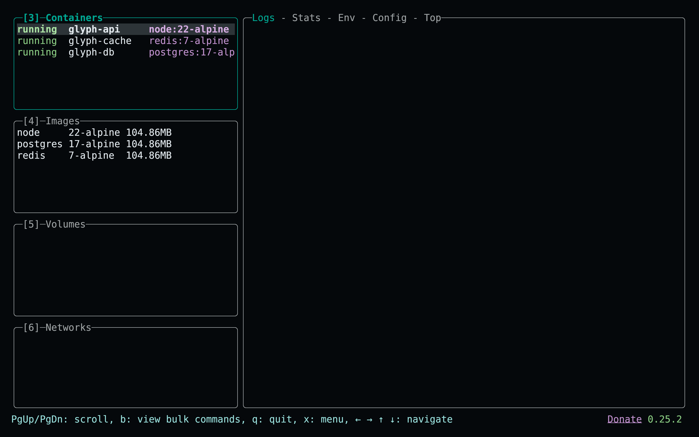
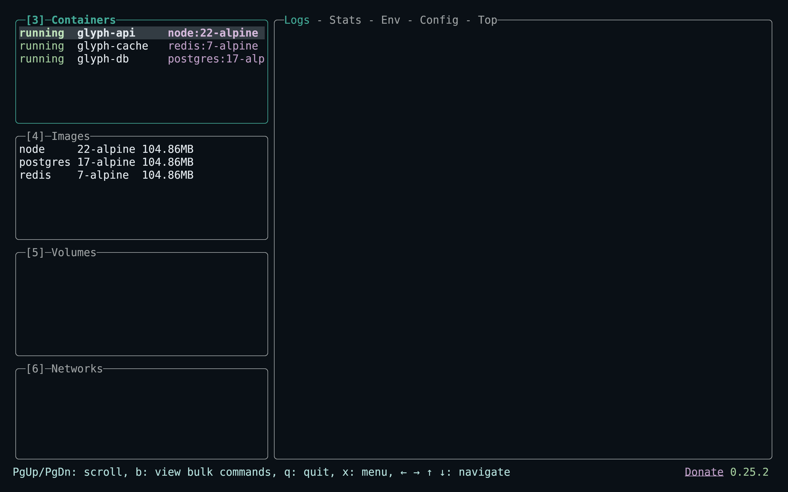
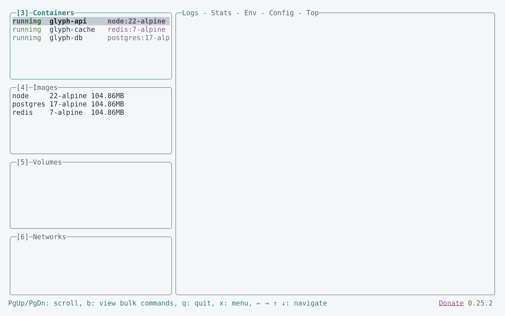
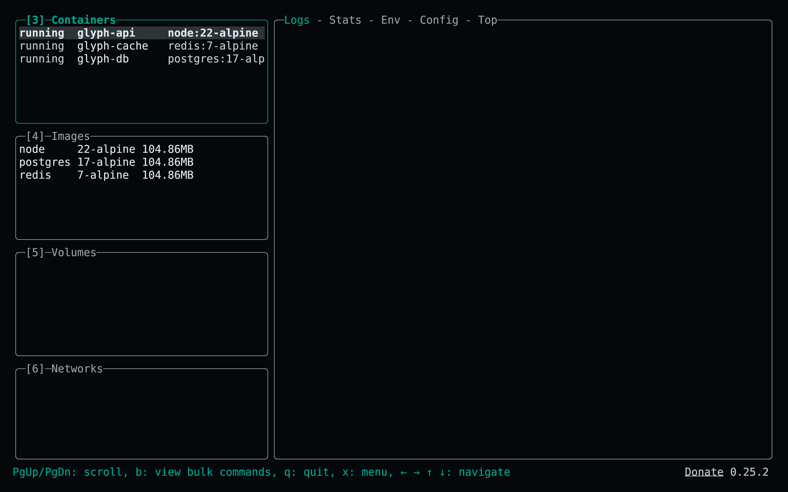

<!-- living-code-readme:1 -->
# 🐳 Living Code for Lazydocker

**Calm slate. Living color.** Living Code for Lazydocker: native YAML overrides for active/inactive borders, selected rows and option text in four flavors.

[Installation](#installation) · [Flavors](#flavors) · [Configuration](#configuration) · [All ports](https://github.com/living-code-theme)

## Previews

<table data-lc-flavors>
<tr>
<td width="50%" valign="top">
<strong>Night</strong><br><sub>Dark · full palette</sub><br><br>
<a href="images/night.png"></a>
</td>
<td width="50%" valign="top">
<strong>Frost</strong><br><sub>Dark · softer chroma</sub><br><br>
<a href="images/frost.png"></a>
</td>
</tr>
<tr>
<td width="50%" valign="top">
<strong>Paper</strong><br><sub>Light · near-white slate</sub><br><br>
<a href="images/paper.png"></a>
</td>
<td width="50%" valign="top">
<strong>Signal</strong><br><sub>Dark · teal accent</sub><br><br>
<a href="images/signal.png"></a>
</td>
</tr>
</table>

Select any preview to view the image at full size.

## Installation

```sh
flavor=night # night, frost, paper, or signal
curl -fsSL --create-dirs -o "${CONFIG_DIR:-${XDG_CONFIG_HOME:-$HOME/.config}/lazydocker}/themes/living-code-$flavor.yml" "https://raw.githubusercontent.com/living-code-theme/lazydocker/main/themes/living-code-$flavor.yml"
```

Open the active Lazydocker config with the project panel’s **o** action. Merge `gui.theme` from the downloaded fragment, replacing only existing theme keys. **Do not overwrite the whole config**: preserve Docker commands and other settings. Restart Lazydocker.

The command above uses Linux’s default config location and respects `CONFIG_DIR`. On macOS, use `~/Library/Application Support/jesseduffield/lazydocker/themes`; on Windows, use `%APPDATA%\lazydocker\themes`. Lazydocker has no separate theme-file import, so the merge is required.

## Flavors

Expand a flavor for its full-size preview and activation instructions.

<details data-lc-flavor="night">
<summary><strong>Night</strong> · Dark · full palette</summary>

<p><a href="images/night.png"></a></p>

Merge `gui.theme` from the downloaded `living-code-night.yml` into the active Lazydocker config and restart.

</details>

<details data-lc-flavor="frost">
<summary><strong>Frost</strong> · Dark · softer chroma</summary>

<p><a href="images/frost.png"></a></p>

Merge `gui.theme` from the downloaded `living-code-frost.yml` into the active Lazydocker config and restart.

</details>

<details data-lc-flavor="paper">
<summary><strong>Paper</strong> · Light · near-white slate</summary>

<p><a href="images/paper.png"></a></p>

Merge `gui.theme` from the downloaded `living-code-paper.yml` into the active Lazydocker config and restart.

</details>

<details data-lc-flavor="signal">
<summary><strong>Signal</strong> · Dark · teal accent</summary>

<p><a href="images/signal.png"></a></p>

Merge `gui.theme` from the downloaded `living-code-signal.yml` into the active Lazydocker config and restart.

</details>

## Configuration

Only the four exposed theme attributes are changed: `activeBorderColor`, `inactiveBorderColor`, `selectedLineBgColor`, and `optionsTextColor`. Each is the native array of color/style attributes. Active borders are bold. Do not replace your full config with the fragment unless you intentionally want all other settings to return to defaults.

## Compatibility

For Lazydocker’s `gui.theme` attribute API with hex-color support. This is intentionally a partial UI theme: terminal foreground/background, container health labels and other hard-coded colors are not individually configurable by this API. Use a matching Living Code terminal palette. Tests validate native YAML and the exact field contract; no Docker daemon is needed for maintenance.

Previews are captured programmatically from the actual application in an isolated profile. See [`capture/app.py`](capture/app.py) for the app-owned recipe and [`images/capture.json`](images/capture.json) for runtime, palette and image provenance. No mock interface is drawn.

## Contributing

Found a problem? [Open an issue](https://github.com/living-code-theme/lazydocker/issues/new/choose) with the app version, the flavor and a screenshot. Want Living Code somewhere else? [Request a port](https://github.com/living-code-theme/core/issues/new?template=port-request.yml).

Pull requests are welcome. Keep this README, `port.json` and `images/` in sync, and use real screenshots of the app, never mockups.

🦎 **One chameleon, many habitats.** Part of [Living Code](https://github.com/living-code-theme).

## License

[MIT](LICENSE) © Elliot Luque
